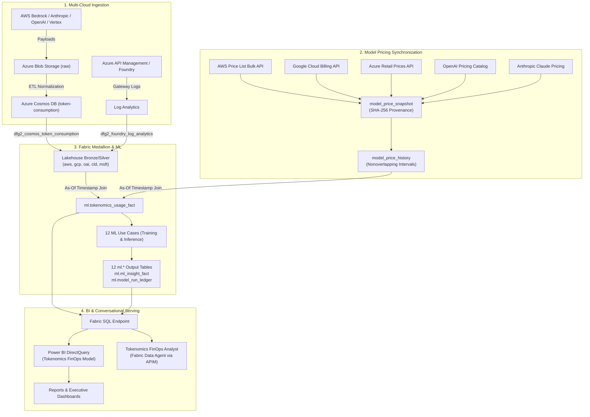
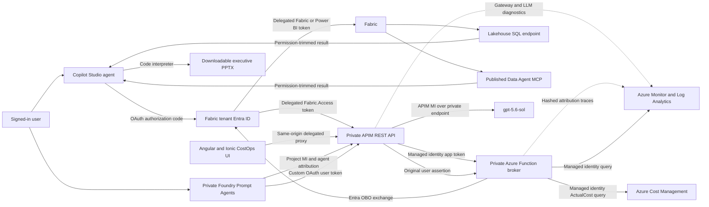
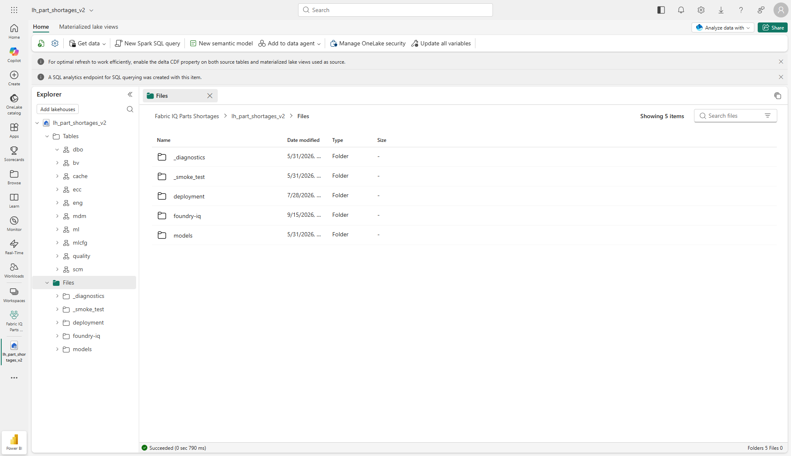
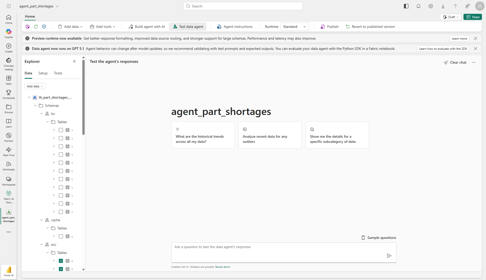
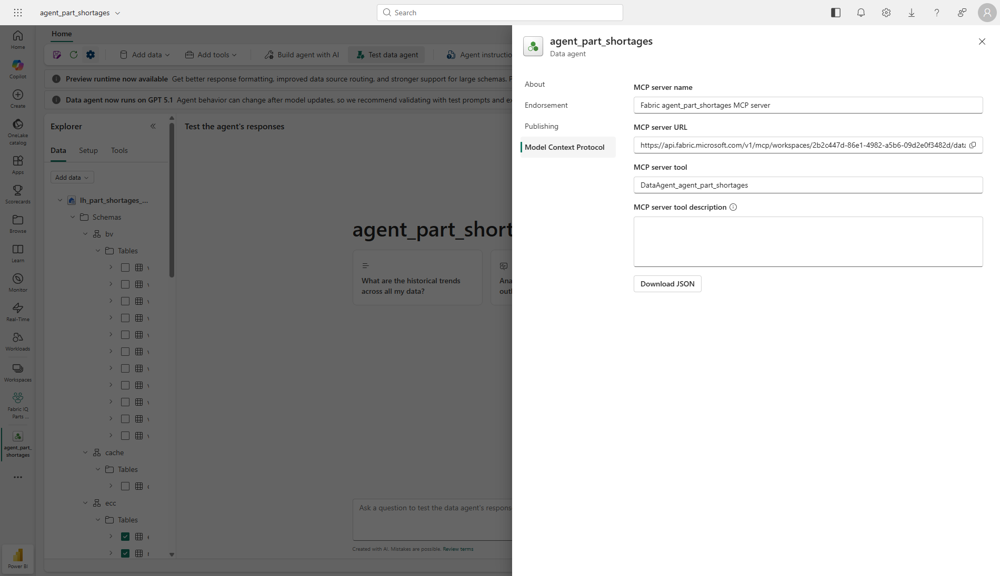

# Microsoft Fabric AI Tokenomics & CostOps Platform

Enterprise multi-cloud AI FinOps, token consumption analytics, and predictive machine learning on **Microsoft Fabric**. This platform ingests, normalizes, and reconciles token consumption across **AWS Bedrock**, **Google Cloud Vertex AI**, **OpenAI Direct**, **Anthropic Claude**, and **Azure OpenAI / Microsoft Foundry** into a governed Medallion Lakehouse architecture with 12 production PySpark ML models, Power BI semantic models and dashboards, and a responsive Angular/Ionic CostOps UI.

> **Sister Repository:** For caller-delegated Microsoft Foundry and Copilot Studio On-Behalf-Of (OBO) gateway integration with Microsoft Fabric Lakehouse and Data Agents, see [Foundry-Fabric-OBO-Gateway](https://github.com/csdmichael/Foundry-Fabric-OBO-Gateway).

## Contents

- [Architecture](#architecture)
- [Data flow and model pricing ingestion](#data-flow-and-model-pricing-ingestion)
- [Tokenomics data platform](#tokenomics-data-platform)
- [ML notebooks](#ml-notebooks)
- [Direct URLs and portals](#direct-urls-and-portals)
- [Live Caldova workspace and Power BI](#live-caldova-workspace-and-power-bi)
- [Reference Fabric screenshots](#reference-fabric-screenshots)
- [Security boundaries](#security-boundaries)
- [Prerequisites](#prerequisites)
- [Configuration](#configuration)
- [Deployment paths](#deployment-paths)
- [Infrastructure ownership and deployment guardrails](#infrastructure-ownership-and-deployment-guardrails)
- [Tokenomics and responsive UI](#tokenomics-and-responsive-ui)
- [Validation and acceptance](#validation-and-acceptance)
- [References](#references)

## Architecture


The main architecture unifies AWS Bedrock, GCP Vertex AI, OpenAI, Claude, and Microsoft Foundry usage into one FinOps control plane. Raw provider events land in private Azure Blob Storage, normalization produces a governed operational record in Cosmos DB, and Fabric Dataflow Gen2 definitions ingest Cosmos and Microsoft Foundry Log Analytics data into a schema-enabled Lakehouse. Source tables use the `aws`, `gcp`, `oai`, `cld`, and `msft` schemas; training and inference notebooks publish all analytical results under the `ml` schema. Power BI consumes the Gold and ML tables for cost, chargeback, segmentation, optimization, capacity, and executive adoption views.

### Medallion data lifecycle


The medallion view describes the quality boundary inside the Tokenomics platform:

1. **Raw source and Bronze:** immutable provider payloads are retained in Blob Storage and copied into Bronze OneLake paths with ingestion metadata.
2. **Operational cleansing and Silver:** ETL normalizes provider-specific fields into Cosmos DB and Fabric source schemas, deduplicates events, rejects invalid records, hashes user identifiers, and keeps actual, negotiated, and market costs distinct.
3. **Business-ready Gold:** Fabric joins effective-dated ownership, budgets, rate cards, outcomes, and capacity signals into auditable FinOps facts.
4. **Data Science and ML:** PySpark pipelines write predictions, scores, recommendations, model manifests, validation metrics, and run ledgers only to `ml` tables.
5. **BI and reporting:** Power BI reads governed Gold and ML outputs rather than raw payloads, preserving lineage from dashboard metrics back to source events and model versions.

## Data flow and model pricing ingestion

The Tokenomics platform coordinates multi-cloud telemetry ingestion, model pricing synchronization, Medallion Lakehouse transformations, PySpark ML analytics, and governed Power BI and Data Agent consumption.



### Model pricing API endpoints

Model pricing ingestion queries official catalog and published endpoints, computes SHA-256 provenance hashes for auditable snapshot storage in `model_price_snapshot`, and builds contiguous, nonoverlapping `[effective_from, effective_to)` rate records with market and negotiated discount pricing in `model_price_history`:

| Provider / Cloud | Source name | Endpoint URI | Type / Protocol | Auth mode | Parser / Contract |
| --- | --- | --- | --- | --- | --- |
| AWS Bedrock (`aws`) | AWS Price List Bulk API | `https://pricing.us-east-1.amazonaws.com/offers/v1.0/aws/AmazonBedrock/current/index.json` | Catalog REST API / JSON | Anonymous | `aws_bedrock_bulk` |
| Google Cloud Vertex AI (`gcp`) | Google Cloud Billing Catalog API | `https://cloudbilling.googleapis.com/v1/services` | Catalog REST API / JSON | API Key or OAuth 2.0 | `gcp_cloud_billing` |
| Microsoft Azure / Foundry (`msft`) | Azure Retail Prices API | `https://prices.azure.com/api/retail/prices` | Public REST API / OData JSON | Anonymous | `azure_retail_prices` |
| OpenAI (`oai`) | OpenAI API Pricing Catalog | `https://openai.com/api/pricing/` | Published catalog / Structured Markdown | Anonymous / Curated snapshot | `approved_snapshot` |
| Anthropic Claude (`cld`) | Anthropic Claude Pricing | `https://platform.claude.com/docs/en/about-claude/pricing` | Published catalog / Structured Markdown | Anonymous / Curated snapshot | `approved_snapshot` |

### Pipeline data flow stages

1. **Ingestion & Raw Landing:**
   - Multi-cloud AI invocations outside Azure are streamed into private Azure Blob Storage container `raw` under directory prefixes per provider (`aws`, `gcp`, `oai`, `cld`).
   - Azure API Management captures streaming and non-streaming model telemetry (input/cached/output tokens, latency, status codes, client headers) and streams logs into Azure Log Analytics.
2. **Operational Normalization:**
   - Cleansing pipelines validate schemas, eliminate duplicates, pseudonymize sensitive identities into `user_id_hash`, and write normalized documents to Azure Cosmos DB container `token-consumption` partitioned by `/source_code`.
3. **Price Polling & Provenance Preservation:**
   - Automated price refresh retrieves rates across all five provider endpoints.
   - Raw HTTP responses are hashed with SHA-256 and committed into `model_price_snapshot`.
   - Rates are normalized into effective-dated intervals per model and version in `model_price_history`, capturing input, cached input, cache write, and output token costs per million for both market list prices and negotiated enterprise discount tiers.
4. **Lakehouse Medallion Staging:**
   - Dataflow Gen2 item `dfg2_cosmos_token_consumption` stages Cosmos DB operational data into Lakehouse Delta tables partitioned by source schema (`aws`, `gcp`, `oai`, `cld`).
   - Dataflow Gen2 item `dfg2_foundry_log_analytics` extracts and normalizes Azure Foundry gateway invocations into the `msft` schema.
5. **Effective-Dated As-Of Cost Enrichment:**
   - PySpark transformations join each token consumption event with `model_price_history` where `event_ts >= effective_from AND (effective_to IS NULL OR event_ts < effective_to)`.
   - Enriched events are committed to `ml.tokenomics_usage_fact`, distinguishing `reported_cost_usd`, `market_cost_usd`, `negotiated_cost_usd`, and `actual_cost_usd`.
6. **Machine Learning Feature Engineering & Scoring:**
   - The 12 use-case training notebooks generate features, train models, and register artifacts.
   - The 12 inference notebooks load approved models and generate predictions, scores, allocations, or recommendations into dedicated `ml` tables (e.g., `ml.anomaly_detection_output`, `ml.cost_forecast_output`), centralized in `ml.ml_insight_fact`, with run metadata logged to `ml.model_run_ledger`.
7. **Downstream Analytics & Delivery:**
   - The Fabric SQL analytics endpoint exposes all 16 tables via DirectQuery to `Tokenomics FinOps Model`.
   - Power BI renders `Tokenomics Consumption and Cost Analytics` (with date, team, user, project, provider, and model slicers) and `Tokenomics ML Insights` reports and dashboards.
   - The Fabric Data Agent (`Tokenomics FinOps Analyst`) serves conversational queries over the governed ML facts through the private APIM gateway.

## Tokenomics data platform

The additive Tokenomics data plane is configured in [config/deployment.json](config/deployment.json). It standardizes AWS Bedrock (`aws`), Google Vertex AI (`gcp`), OpenAI (`oai`), Anthropic Claude (`cld`), and Microsoft Foundry (`msft`) usage without mixing provider-reported, estimated, negotiated, and billed costs.

| Capability | Implemented state | Live state |
| --- | --- | --- |
| Fabric foundation | Idempotent workspace, capacity, Lakehouse, SQL endpoint, and Dataflow provisioning in [scripts/provision-tokenomics-fabric.ps1](scripts/provision-tokenomics-fabric.ps1) | `Fabric AI Tokenomics`, `lh_tokenomics`, and both Dataflow items are live |
| Source ingestion | Cosmos readback fingerprint, config-driven Delta materialization, replace-safe OneLake upload, and SQL endpoint verification in [scripts/sync-tokenomics-to-fabric.ps1](scripts/sync-tokenomics-to-fabric.ps1) | The executable sync promotes only the exact snapshot verified in Cosmos; source-only Dataflows remain available for future managed refresh |
| Synthetic usage | Deterministic 12,000-interval, 500-user generator representing 13.6 million requests and 85.3 billion tokens, with balanced providers, hashed users, anomaly seeds, business outcomes, budgets, quotas, capacity, and model benchmarks | Large-enterprise sample scale is enforced by tests; each live seed is fingerprinted after Cosmos readback |
| Model pricing | Provider source registry, immutable snapshots, effective-dated history, provenance hashes, and deterministic as-of enrichment | Seed contracts are implemented; live API/page retrieval and scheduled persistence remain pending |
| ML | Twelve use cases, one training and one inference notebook per use case, source schema contract, and `ml` output schema contract | The 24 target notebook names are configured but not yet generated and published |
| Governed analytics | `Tokenomics FinOps Model`, two Power BI reports, two service dashboards, and `Tokenomics FinOps Analyst` contracts | Definitions are implemented; publication is blocked until all 16 required `ml` tables pass preflight |

Pricing is deliberately effective-dated and auditable, governed by the pipeline in [Data flow and model pricing ingestion](#data-flow-and-model-pricing-ingestion):

- Synthetic `reported_cost_usd` is calculated with the one price interval effective at the event timestamp. It is test data, not Azure `ActualCost` and not proof of a negotiated invoice amount.
- Rate cards maintain separate market and negotiated tiers across nonoverlapping intervals, ensuring auditability and reproducible historical cost reconstruction.

Run the deterministic contract checks with Node.js 22:

```powershell
npm ci --prefix scripts/tokenomics --no-audit --no-fund
npm test --prefix scripts/tokenomics
node scripts/tokenomics/generate-data.mjs --config config/deployment.json
pwsh scripts/provision-tokenomics-fabric.ps1 -ValidateOnly
```

## ML notebooks

The target Fabric hierarchy is `ML/<use-case folder>/<notebook>`. Each use case has a PySpark training/feature-engineering notebook and a separate inference/prediction notebook, for 24 notebooks across 12 folders.

> **Implementation status:** The exact hierarchy and names below are validated in [config/deployment.json](config/deployment.json). At this checkpoint, the repository contains only a bootstrap training draft; generation, folder reconciliation, and publication of the complete 24-notebook set are still pending. The manifest is the source of truth until Fabric inventory readback confirms every item.

| Use case | Folder under `ML` | Training notebook | Inference notebook |
| --- | --- | --- | --- |
| Anomaly Detection | `01 - Anomaly Detection` | `01 - Anomaly Detection - Training` | `01 - Anomaly Detection - Inference` |
| Cost Forecasting | `02 - Cost Forecasting` | `02 - Cost Forecasting - Training` | `02 - Cost Forecasting - Inference` |
| Cost Attribution and Chargeback | `03 - Cost Attribution and Chargeback` | `03 - Cost Attribution and Chargeback - Training` | `03 - Cost Attribution and Chargeback - Inference` |
| User Segmentation | `04 - User Segmentation` | `04 - User Segmentation - Training` | `04 - User Segmentation - Inference` |
| Token Efficiency Scoring | `05 - Token Efficiency Scoring` | `05 - Token Efficiency Scoring - Training` | `05 - Token Efficiency Scoring - Inference` |
| Budget Overrun Prediction | `06 - Budget Overrun Prediction` | `06 - Budget Overrun Prediction - Training` | `06 - Budget Overrun Prediction - Inference` |
| Model Optimization Recommendation Engine | `07 - Model Optimization Recommendation Engine` | `07 - Model Optimization Recommendation Engine - Training` | `07 - Model Optimization Recommendation Engine - Inference` |
| Agent ROI Analytics | `08 - Agent ROI Analytics` | `08 - Agent ROI Analytics - Training` | `08 - Agent ROI Analytics - Inference` |
| Intelligent Quota Management | `09 - Intelligent Quota Management` | `09 - Intelligent Quota Management - Training` | `09 - Intelligent Quota Management - Inference` |
| Prompt Quality Analytics | `10 - Prompt Quality Analytics` | `10 - Prompt Quality Analytics - Training` | `10 - Prompt Quality Analytics - Inference` |
| Capacity Planning | `11 - Capacity Planning` | `11 - Capacity Planning - Training` | `11 - Capacity Planning - Inference` |
| Executive AI Adoption Scorecard | `12 - Executive AI Adoption Scorecard` | `12 - Executive AI Adoption Scorecard - Training` | `12 - Executive AI Adoption Scorecard - Inference` |

All notebook pairs share these contracts:

- Read governed Delta inputs from `aws`, `gcp`, `oai`, `cld`, and `msft`; resolve ownership and price history as of each event timestamp.
- Use the built-in Microsoft Fabric Spark session and PySpark transformations suitable for distributed data. Do not create a standalone `SparkSession`.
- Training notebooks publish feature definitions, validation metrics, model manifests, and run ledgers. Inference notebooks load an approved model version and publish repeatable scores, forecasts, classifications, recommendations, or allocations.
- Write analytical outputs only under the `ml` schema with run ID, model version, scoring timestamp, and source lineage so Power BI and the Data Agent can explain each result.
- Keep actual billed cost, provider-reported cost, market estimates, negotiated estimates, and predicted savings as separately named measures.

### Power BI reports and dashboards

[scripts/tokenomics/generate-powerbi.mjs](scripts/tokenomics/generate-powerbi.mjs) deterministically generates the semantic model and report definitions. [scripts/publish-tokenomics-powerbi.ps1](scripts/publish-tokenomics-powerbi.ps1) validates every required Lakehouse table and column before it creates or updates any Power BI artifact.

| Artifact | Coverage | Current state |
| --- | --- | --- |
| `Tokenomics FinOps Model` | Four shared reporting tables plus one table for each of the 12 ML outputs | 16-table TMSL definition implemented; not live because the Lakehouse tables do not exist yet |
| `Tokenomics Consumption and Cost Analytics` | Executive Overview; expandable User > Model Family > Provider > Model > Version and Provider > Model Family > Model > Version > User matrices; Usage and Cost Explorer; Chargeback and Allocation; Model Economics | Six-page PBIR-Legacy definition implemented; live publication pending |
| `Tokenomics ML Insights` | Portfolio overview, one detailed page per ML use case, and Model Governance | Fourteen-page PBIR-Legacy definition implemented; live publication pending |
| `Tokenomics FinOps Executive Dashboard` | Live Executive Overview page from the consumption/cost report | Dashboard contract and idempotent shell creation implemented; live-page pin pending |
| `Tokenomics ML Operations Dashboard` | Live ML Portfolio Overview page from the ML report | Dashboard contract and idempotent shell creation implemented; live-page pin pending |

The consumption model and report expose date/time, team, hashed user, project, department, business unit, cost center, application, environment, provider, model family, model, model version, and task type. Sample-data visuals keep requests, input/cached/output/total tokens, reported cost, market cost, negotiated cost, and predicted savings separate. `actual_cost_usd` remains blank until a verified Azure billing allocation is loaded.

The user and provider matrix pages start with high-level totals and expose expand/collapse controls for each hierarchy level. Every level retains `Total Tokens`, `Reported Cost`, `Market Cost`, and `Negotiated Cost`, with date, team, and project slicers available on both pages.

The configured slicer fields are `event_ts`, `usage_date`, `team_id`, `user_id_hash`, `project_id`, `department_id`, `business_unit_id`, `cost_center_id`, `application_id`, `environment`, `source_code`, `model_family`, `model_name`, `model_version`, and `task_type`.

The ML report reads a standardized output contract for every algorithm: run/scoring timestamps, entity, business and model dimensions, metric/value/unit, risk score, probability, predicted cost, estimated savings, recommendation, scoring model version, and source lineage. Its 12 detailed pages are generated directly from the configured use-case manifest, so an algorithm cannot be omitted without failing tests.

Power BI dashboards are service-only artifacts. The REST API can create dashboard shells, but it does not create a new live report-page tile. After report publication, the publisher verifies the expected source-report tile and emits the exact **Pin live** portal action until each dashboard is complete.

```powershell
# Generate and validate all definitions without cloud mutation.
pwsh scripts/publish-tokenomics-powerbi.ps1 -DefinitionOnly

# Validate the live Lakehouse tables and columns without publishing.
pwsh scripts/publish-tokenomics-powerbi.ps1 -PreflightOnly

# Publish only after ingestion and all 12 inference outputs pass preflight.
pwsh scripts/publish-tokenomics-powerbi.ps1
```

### Private access and delegated identity



The token path is:

1. The user signs in to a Power Platform OAuth custom connector registered in the Fabric resource tenant.
2. The connector sends a delegated v2 token for `api://<resource-api-client-id>/Fabric.Access` to APIM.
3. APIM validates tenant, audience, scope, connector client ID, user object ID, and token type.
4. APIM acquires an application token for the broker with its system-assigned managed identity and forwards the original user assertion separately.
5. The broker independently validates both tokens, then performs Microsoft Entra OBO for the fixed downstream scope.
6. Fabric applies the user's workspace, item, table, row-level, and column-level permissions.

This delegation follows the [Microsoft identity platform OBO flow](https://learn.microsoft.com/entra/identity-platform/v2-oauth2-on-behalf-of-flow). APIM performs gateway-side JWT validation with [`validate-jwt`](https://learn.microsoft.com/azure/api-management/validate-jwt-policy), obtains the broker token with [`authentication-managed-identity`](https://learn.microsoft.com/azure/api-management/authentication-managed-identity-policy), and enforces per-user throttling with [`rate-limit-by-key`](https://learn.microsoft.com/azure/api-management/rate-limit-by-key-policy).

## Direct URLs and portals

The status column is intentional. **Live** links identify deployed artifacts. **Local** links work on this machine while the development server is running. **Post-deploy** URLs are deterministic private endpoints from [config/deployment.json](config/deployment.json), but they must not be treated as available until deployment and acceptance pass. The private APIM and Function URLs require an authorized network path and valid Microsoft Entra token.

| Surface | Direct URL | Status |
| --- | --- | --- |
| CostOps tokenomics UI | [http://localhost:4200/](http://localhost:4200/) | Local development |
| UI production URL | [https://caldova-fabric-costops-ui.azurewebsites.net](https://caldova-fabric-costops-ui.azurewebsites.net) | Live; public host, authenticated data |
| Tokenomics Fabric workspace | [Fabric AI Tokenomics](https://app.fabric.microsoft.com/groups/1e14d1a0-d6cd-4810-a23e-094a58dae55e?ctid=12a4b86b-e64c-43f9-af05-d9130a72dfd2) | Live foundation |
| Tokenomics Lakehouse | [lh_tokenomics](https://app.fabric.microsoft.com/groups/1e14d1a0-d6cd-4810-a23e-094a58dae55e/lakehouses/2963b5a6-900d-4364-b141-16913bf4548b?ctid=12a4b86b-e64c-43f9-af05-d9130a72dfd2) | Live; SQL endpoint ready, tables pending |
| APIM service in Azure portal | [caldova-apim-westus overview](https://portal.azure.com/#@12a4b86b-e64c-43f9-af05-d9130a72dfd2/resource/subscriptions/cf824570-a8ba-497a-a184-0a52f1830aa9/resourceGroups/m365-myaacoub/providers/Microsoft.ApiManagement/service/caldova-apim-westus/overview) | Live shared service |
| APIM `fabric` product | [fabric product](https://portal.azure.com/#@12a4b86b-e64c-43f9-af05-d9130a72dfd2/resource/subscriptions/cf824570-a8ba-497a-a184-0a52f1830aa9/resourceGroups/m365-myaacoub/providers/Microsoft.ApiManagement/service/caldova-apim-westus/products/fabric) | Live; published |
| APIM `foundry` product | [foundry product](https://portal.azure.com/#@12a4b86b-e64c-43f9-af05-d9130a72dfd2/resource/subscriptions/cf824570-a8ba-497a-a184-0a52f1830aa9/resourceGroups/m365-myaacoub/providers/Microsoft.ApiManagement/service/caldova-apim-westus/products/foundry) | Live; published |
| APIM private gateway | [https://caldova-apim-westus.azure-api.net](https://caldova-apim-westus.azure-api.net) | Live gateway; private access |
| Lakehouse table discovery | [https://caldova-apim-westus.azure-api.net/fabric-lakehouse/tables](https://caldova-apim-westus.azure-api.net/fabric-lakehouse/tables) | Live; delegated access |
| Lakehouse read-only query | [https://caldova-apim-westus.azure-api.net/fabric-lakehouse/query](https://caldova-apim-westus.azure-api.net/fabric-lakehouse/query) | Live; delegated access |
| Lakehouse MCP | [https://caldova-apim-westus.azure-api.net/fabric-lakehouse-mcp/mcp](https://caldova-apim-westus.azure-api.net/fabric-lakehouse-mcp/mcp) | Live; delegated access |
| Data Agent query | [https://caldova-apim-westus.azure-api.net/fabric-data-agent/query](https://caldova-apim-westus.azure-api.net/fabric-data-agent/query) | Live; delegated access |
| Data Agent MCP | [https://caldova-apim-westus.azure-api.net/fabric-data-agent-mcp/mcp](https://caldova-apim-westus.azure-api.net/fabric-data-agent-mcp/mcp) | Live; delegated access |
| Tokenomics summary API | [https://caldova-apim-westus.azure-api.net/fabric-tokenomics/summary](https://caldova-apim-westus.azure-api.net/fabric-tokenomics/summary) | Live; delegated access |
| Lakehouse model gateway | [https://caldova-apim-westus.azure-api.net/fabric-foundry-inference/lakehouse](https://caldova-apim-westus.azure-api.net/fabric-foundry-inference/lakehouse) | Live; project managed identity only |
| Data Agent model gateway | [https://caldova-apim-westus.azure-api.net/fabric-foundry-inference/data-agent](https://caldova-apim-westus.azure-api.net/fabric-foundry-inference/data-agent) | Live; project managed identity only |
| Private Foundry account | [foundry-fabric-costops overview](https://portal.azure.com/#@12a4b86b-e64c-43f9-af05-d9130a72dfd2/resource/subscriptions/cf824570-a8ba-497a-a184-0a52f1830aa9/resourceGroups/m365-myaacoub/providers/Microsoft.CognitiveServices/accounts/foundry-fabric-costops/overview) | Live; private access |
| Foundry project endpoint | [https://foundry-fabric-costops.services.ai.azure.com/api/projects/fabric-costops](https://foundry-fabric-costops.services.ai.azure.com/api/projects/fabric-costops) | Live; private access |
| Broker Function in Azure portal | [caldova-fabric-obo-fn overview](https://portal.azure.com/#@12a4b86b-e64c-43f9-af05-d9130a72dfd2/resource/subscriptions/cf824570-a8ba-497a-a184-0a52f1830aa9/resourceGroups/m365-myaacoub/providers/Microsoft.Web/sites/caldova-fabric-obo-fn/overview) | Live; private access |
| Broker private health endpoint | [https://caldova-fabric-obo-fn.azurewebsites.net/api/health](https://caldova-fabric-obo-fn.azurewebsites.net/api/health) | Live; private access |
| Native Fabric Data Agent MCP | [https://api.fabric.microsoft.com/v1/mcp/workspaces/53829079-597d-4c27-9897-6a2042473761/dataagents/25696ea2-a91e-4b18-9846-5d045c6a082e/agent](https://api.fabric.microsoft.com/v1/mcp/workspaces/53829079-597d-4c27-9897-6a2042473761/dataagents/25696ea2-a91e-4b18-9846-5d045c6a082e/agent) | Live; Fabric bearer token required |
| Power Platform environment | [Caldova Private in Power Apps](https://make.powerapps.com/environments/52456fcd-1d20-ecdb-aa2e-8979e3f794f5/home) | Live environment |
| Copilot Studio environment | [Caldova Private in Copilot Studio](https://copilotstudio.microsoft.com/environments/52456fcd-1d20-ecdb-aa2e-8979e3f794f5/home) | Live environment |

Live agent deep links require immutable version IDs. Add the Copilot Studio bot IDs and Foundry Prompt Agent versions here only after publication and a successful live readback. Until then, use the deterministic project endpoint and source links below.

## Live Caldova workspace and Power BI

These links point to the deployed Caldova tenant artifacts and require an authorized Caldova account.

| Artifact | Link |
| --- | --- |
| Fabric workspace | [Fabric IQ Parts Shortages](https://app.fabric.microsoft.com/groups/53829079-597d-4c27-9897-6a2042473761?ctid=12a4b86b-e64c-43f9-af05-d9130a72dfd2) |
| Lakehouse | [lh_part_shortages_v2](https://app.fabric.microsoft.com/groups/53829079-597d-4c27-9897-6a2042473761/lakehouses/a757a457-6402-4c2a-bf5e-1f80d55f68e8?ctid=12a4b86b-e64c-43f9-af05-d9130a72dfd2) |
| Fabric Data Agent | [agent_part_shortages](https://app.fabric.microsoft.com/groups/53829079-597d-4c27-9897-6a2042473761/aiskills/25696ea2-a91e-4b18-9846-5d045c6a082e?ctid=12a4b86b-e64c-43f9-af05-d9130a72dfd2) |
| Power BI semantic model | [sm_part_shortages](https://app.powerbi.com/groups/53829079-597d-4c27-9897-6a2042473761/datasets/18be2ce1-3566-437d-971d-c4532e2e3575?ctid=12a4b86b-e64c-43f9-af05-d9130a72dfd2) |
| Power BI report | [Fabric Parts Shortages Executive Analytics](https://app.powerbi.com/groups/53829079-597d-4c27-9897-6a2042473761/reports/33c7ffc1-69d9-4a9c-a6a7-fdb9417c29f9?ctid=12a4b86b-e64c-43f9-af05-d9130a72dfd2) |
| Power BI report | [shortages-executive-report](https://app.powerbi.com/groups/53829079-597d-4c27-9897-6a2042473761/reports/b061fa31-6ed0-4415-80f8-9e58fba07d26?ctid=12a4b86b-e64c-43f9-af05-d9130a72dfd2) |
| Power BI report | [spm-feedback-and-resolution-report](https://app.powerbi.com/groups/53829079-597d-4c27-9897-6a2042473761/reports/8c02521b-b2c3-4309-83c2-6ce4391c5b1a?ctid=12a4b86b-e64c-43f9-af05-d9130a72dfd2) |
| Power BI dashboard | [Fabric Parts Shortages Executive Dashboard](https://app.powerbi.com/groups/53829079-597d-4c27-9897-6a2042473761/dashboards/871a0eea-fd2b-40d0-bb94-34c031975f03?ctid=12a4b86b-e64c-43f9-af05-d9130a72dfd2) |
| Power BI dashboard | [Fabric Supply Risk Dashboard](https://app.powerbi.com/groups/53829079-597d-4c27-9897-6a2042473761/dashboards/e32f630f-3ea1-41d9-8943-3c319051159f?ctid=12a4b86b-e64c-43f9-af05-d9130a72dfd2) |

## Reference Fabric screenshots

These images are actual reference-tenant views captured on 2026-09-16. They contain no token, password, client secret, APIM subscription key, or query result.

### Lakehouse and SQL analytics endpoint

**Browser URL:** <https://app.powerbi.com/groups/2b2c447d-86e1-4982-a5b6-09d2e0f3482d/lakehouses/d487748c-006e-4945-a2ac-9ddb26c999f1?ctid=b158173c-91f6-4f99-b5e9-aa9bcb463863&experience=power-bi&selectedPath=Files>

The Lakehouse view confirms the configured `lh_part_shortages_v2` item, its schema-enabled tables, files, and SQL analytics endpoint.



### Fabric Data Agent

**Browser URL:** <https://app.fabric.microsoft.com/groups/2b2c447d-86e1-4982-a5b6-09d2e0f3482d/aiskills/2ec6cb5e-2f5c-44e7-9c0d-a113cb372741?ctid=b158173c-91f6-4f99-b5e9-aa9bcb463863>

The Data Agent view confirms `agent_part_shortages`, its bound Lakehouse, selected schemas, test surface, and publish controls.



### Published Data Agent MCP endpoint

**Browser URL:** <https://app.fabric.microsoft.com/groups/2b2c447d-86e1-4982-a5b6-09d2e0f3482d/aiskills/2ec6cb5e-2f5c-44e7-9c0d-a113cb372741?ctid=b158173c-91f6-4f99-b5e9-aa9bcb463863>

Navigation: **Data Agent > Settings > Model Context Protocol**.

The MCP view confirms the server name, published endpoint, and single tool identifier. The endpoint is configuration, not a credential; every request still requires a valid Fabric bearer token.



## Security boundaries

- The broker accepts calls only from the configured APIM system-assigned identity and requires the `Fabric.Broker.Invoke` application role.
- User assertions must be v2 delegated tokens from the Fabric resource tenant with `Fabric.Access`, an approved connector `azp`, and an explicitly allowed user `oid`.
- OBO requests use only `https://api.fabric.microsoft.com/.default` or `https://analysis.windows.net/powerbi/api/.default`.
- The resource app requests only `DataAgent.Execute.All`, `Lakehouse.Read.All`, and `SQLEndpoint.Read.All` delegated permissions.
- Lakehouse SQL accepts one read-only `SELECT` or CTE, rejects multiple statements and write primitives, and caps input length and returned rows.
- Tokens and bodies are not logged. Responses are marked `no-store`.
- The OBO client secret is written through the write-only Key Vault ARM child resource while the vault remains private; it never enters source, generated metadata, command output, Terraform state, or screenshots.
- Connector credentials are generated in memory and sent directly to Power Platform.

The connector design follows [Copilot Studio OBO authentication for custom connectors](https://learn.microsoft.com/microsoft-copilot-studio/advanced-custom-connector-on-behalf-of), and Foundry connections must use [OAuth identity passthrough for MCP authentication](https://learn.microsoft.com/azure/foundry/agents/how-to/mcp-authentication). Neither path may substitute a shared application identity for the signed-in user.

## Prerequisites

Use accounts with the following narrowly scoped privileges:

- Fabric workspace and item read/admin rights needed to inspect the Lakehouse, Data Agent, and user grants.
- Azure rights to validate deployments, create resources, peer the configured VNets, and assign the template's scoped roles.
- Microsoft Entra rights to manage app registrations, service principals, delegated consent, and the APIM managed-identity app-role assignment.
- Power Platform environment administration in a Managed Environment with Dataverse.
- Copilot Studio authoring, solution import, code interpreter, and publish privileges.

The configured Power Platform environment must be resolved by ID before connector or agent mutation. Do not create a replacement environment automatically.

### Workspace Private Link gate

Microsoft Fabric workspace-level Private Link is intentionally disabled in [config/deployment.json](config/deployment.json). This workspace contains Power BI semantic models, which are incompatible with that workspace restriction. Do not enable inbound restriction or delete/move those items automatically. The customer-owned APIM and broker VNets can still be peered; Fabric remains a multitenant downstream service reached with delegated HTTPS tokens.

## Configuration

All nonsecret customer inputs live in [config/deployment.json](config/deployment.json). Bicep reads that file where supported; PowerShell maps it to required parameters; Terraform exposes equivalent variables and example tfvars.

Before deployment, replace or resolve:

- tenant, subscription, resource group, location, and existing resource IDs;
- Fabric workspace, Lakehouse, SQL endpoint, and Data Agent IDs;
- APIM service, gateway, API paths, product, and VNet;
- dedicated Foundry account/project, exclusive agent subnet, pinned model, and per-agent connections;
- existing Windows App Service plan, broker/UI integration subnet, and production UI URL;
- resource-group `ActualCost` scope, billing lag, and tracked resources;
- Tokenomics workspace/capacity, Lakehouse, Dataflow, pricing-source, ML-use-case, Data Agent, semantic-model, and report settings;
- Power Platform environment ID;
- allowed Fabric-tenant user object IDs.

Never add credentials to this file.

## Deployment paths

Bicep is the live reference deployment path. Terraform is an equivalent customer option; do not let both tools manage the same deployed resources.

### Bicep

Deploy in this order:

1. Deploy [bicep/broker/main.bicep](bicep/broker/main.bicep) with `deployFunction=false`.
2. Deploy the private Foundry foundation in [bicep/foundry/main.bicep](bicep/foundry/main.bicep).
3. Run [scripts/provision-identity.ps1](scripts/provision-identity.ps1); credentials go directly to Key Vault or their platform connection store.
4. Build/upload the Function package and redeploy the broker with generated IDs and `deployFunction=true`.
5. Deploy the REST, MCP, tokenomics, and two model APIs from [bicep/apim/main.bicep](bicep/apim/main.bicep).
6. Deploy the production Web App from [bicep/ui/main.bicep](bicep/ui/main.bicep), then publish [the portable UI package](scripts/build-ui-package.ps1).
7. Deploy the two model connections from [bicep/foundry/connections.bicep](bicep/foundry/connections.bicep).
8. Run [scripts/provision-foundry-agents.ps1](scripts/provision-foundry-agents.ps1) to create OAuth connections, register redirects, version both Prompt Agents, and smoke-test model traffic.
9. Run [scripts/create-connectors.ps1](scripts/create-connectors.ps1), then package, bind, test, and publish Copilot Studio agents.

[scripts/deploy.ps1](scripts/deploy.ps1) implements this order through `broker-base`, `foundry-base`, `identity`, `package`, `broker-app`, `apim`, `ui`, `foundry-connections`, and `foundry-agents` stages.

Run incremental deployments only. Review every `what-if` result and stop on an unexpected delete, replacement, VNet change, APIM service change, or App Service plan change.

### Terraform

Equivalent independent modules are under [terraform](terraform):

- `network-apim-side`
- `network-broker-side`
- `broker`
- `apim`
- `foundry`
- `ui`

Run `terraform fmt -check`, `terraform init -backend=false`, and `terraform validate` before configuring a real backend. Keep state in customer-controlled remote storage; never commit state or tfvars.

### Tokenomics Fabric data plane

The Fabric provisioner currently reconciles the workspace, capacity assignment, schema-enabled Lakehouse/SQL endpoint, and two source-only Dataflow Gen2 definitions. It writes nonsecret item IDs and remaining portal actions to the ignored `.generated/tokenomics/fabric.json` file.

```powershell
# Validate templates and emit local Dataflow definitions without cloud mutation.
pwsh scripts/provision-tokenomics-fabric.ps1 -ValidateOnly

# Reconcile the implemented live Fabric foundation.
pwsh scripts/provision-tokenomics-fabric.ps1
```

This command does not yet create the `ML` folder tree, publish the 24 notebooks, or configure the Tokenomics Data Agent. Those capabilities must not be marked live until the provisioner implements them and a Fabric inventory readback succeeds.

Power BI is a separate, fail-closed deployment step. `-WhatIf` generates and validates definitions only; a live run first verifies all four shared reporting tables and all 12 algorithm output tables, then reconciles the semantic model, both reports, and both dashboard shells.

```powershell
# Seed Cosmos from a commit already pushed to origin/main.
pwsh scripts/deploy.ps1 -Step tokenomics-seed -RepositoryCommit <commit-sha>

# Materialize and upload only the snapshot whose fingerprint was read back from Cosmos.
pwsh scripts/deploy.ps1 -Step tokenomics-sync

pwsh scripts/deploy.ps1 -Step tokenomics-powerbi -WhatIf
pwsh scripts/deploy.ps1 -Step tokenomics-powerbi
```

## Infrastructure ownership and deployment guardrails

- Bicep and Terraform are alternative owners of the same logical resources. Never apply both to one environment unless the resources have first been imported into the selected state.
- Use incremental deployments only. Review `what-if` or `terraform plan` and stop on an unexpected delete, replacement, APIM service mutation, shared VNet change, or App Service plan change.
- Deploy the broker in two stages: infrastructure with `deployFunction=false`, then identity/package provisioning, then the application with `deployFunction=true` and nonempty generated IDs and allowlists.
- The broker UAMI receives only Storage Blob Data Owner, Storage Table Data Contributor, Key Vault Secrets User, Log Analytics Reader, and the resource-group-scoped read-only cost roles documented below. It receives no storage key, queue, generic write, or Key Vault write role.
- The OBO credential is written through the write-only ARM `vaults/secrets` child resource. Key Vault remains private and the secret never enters source, logs, generated metadata, Terraform state, or command output.
- Package and seed uploads to private Storage/Cosmos resources should run from an in-VNet managed identity. Shared-key access remains disabled. Temporary runner roles must be resource-scoped and deleted after verification.
- Blob, Table, Vault, Sites, Cosmos, APIM, and Foundry private DNS links stay scoped to the configured VNets. Workspace-level Fabric Private Link remains disabled while incompatible semantic models and external integrations exist.
- APIM MCP and product features use the preview resource API pinned in the infrastructure source. Application Insights logger/API diagnostics are omitted when no component name is configured.
- The existing Cosmos account is serverless; the Tokenomics child module deliberately sets no manual or autoscale throughput.
- Cross-tenant peering modules, when enabled, must be authenticated and applied independently in their owning subscriptions. Peering is not complete until both sides report `Connected`.

Core validation commands:

```powershell
pwsh scripts/validate.ps1 -DeploymentReady -IncludeParity
az bicep build --file bicep/tokenomics-data/main.bicep
terraform -chdir=terraform/tokenomics-data fmt -check
terraform -chdir=terraform/tokenomics-data init -backend=false
terraform -chdir=terraform/tokenomics-data validate
```

## Identity and consent

[scripts/provision-identity.ps1](scripts/provision-identity.ps1) idempotently creates or reconciles:

- a Fabric-tenant resource API with delegated `Fabric.Access`;
- separate Lakehouse and Data Agent OAuth connector clients;
- principal-scoped delegated access for the two Copilot Studio connector clients;
- managed-identity Foundry IQ access and native signed-in-user Fabric Data Agent access, with no Foundry OAuth connector clients;
- least-privilege downstream Fabric delegated permissions;
- principal-scoped consent for explicitly allowed users;
- a caller-tenant broker API with `Fabric.Broker.Invoke`;
- the APIM managed-identity role assignment.

A Caldova user must exist as a redeemed guest in the Fabric resource tenant before it can receive principal-scoped consent or pass the broker allowlist. Do not replace that requirement with tenant-wide consent.

The script writes only nonsecret IDs to the ignored `.generated` directory. With `-KeyVaultName`, a new resource-API credential goes directly from Microsoft Graph to the write-only Key Vault ARM secret resource and is cleared from process variables. It never enables public vault access.

## APIM APIs and MCP

APIM deploys three REST APIs, two MCP projections, and two model-inference APIs. They are grouped into two published, subscription-free products because authentication is enforced by delegated OAuth or project managed identity rather than APIM subscription keys.

| APIM product | Included APIs |
| --- | --- |
| `fabric` | Fabric Lakehouse REST, Fabric Data Agent REST, Fabric Lakehouse MCP, Fabric Data Agent MCP, and Fabric Tokenomics |
| `foundry` | Lakehouse Prompt Agent inference and Data Agent Prompt Agent inference |

The products are deliberately separate: Fabric data/tool traffic remains visible as `fabric`, while all model traffic is governed and metered under `foundry`. APIM's ability to govern APIs, models, and MCP servers is described in the [AI gateway capabilities reference](https://learn.microsoft.com/azure/api-management/genai-gateway-capabilities).

| Surface | Path | Full private gateway URL | Purpose |
| --- | --- | --- | --- |
| Lakehouse REST | `/fabric-lakehouse` | [https://caldova-apim-westus.azure-api.net/fabric-lakehouse](https://caldova-apim-westus.azure-api.net/fabric-lakehouse) | List visible tables and run one read-only query |
| Lakehouse knowledge | `/fabric-lakehouse/knowledge` | [https://caldova-apim-westus.azure-api.net/fabric-lakehouse/knowledge](https://caldova-apim-westus.azure-api.net/fabric-lakehouse/knowledge) | Return up to 15 citation-ready open-shortage snippets for Copilot Studio knowledge grounding |
| Lakehouse MCP | `/fabric-lakehouse-mcp/mcp` | [https://caldova-apim-westus.azure-api.net/fabric-lakehouse-mcp/mcp](https://caldova-apim-westus.azure-api.net/fabric-lakehouse-mcp/mcp) | MCP projection of the governed REST operations |
| Data Agent REST | `/fabric-data-agent` | [https://caldova-apim-westus.azure-api.net/fabric-data-agent](https://caldova-apim-westus.azure-api.net/fabric-data-agent) | Proxy one natural-language Data Agent request |
| Data Agent MCP | `/fabric-data-agent-mcp/mcp` | [https://caldova-apim-westus.azure-api.net/fabric-data-agent-mcp/mcp](https://caldova-apim-westus.azure-api.net/fabric-data-agent-mcp/mcp) | MCP projection of the governed REST operation |
| Tokenomics REST | `/fabric-tokenomics/summary` | [https://caldova-apim-westus.azure-api.net/fabric-tokenomics/summary](https://caldova-apim-westus.azure-api.net/fabric-tokenomics/summary) | Return a fixed, privacy-preserving usage and cost summary; never accepts caller-supplied KQL |
| Lakehouse inference | `/fabric-foundry-inference/lakehouse` | [https://caldova-apim-westus.azure-api.net/fabric-foundry-inference/lakehouse](https://caldova-apim-westus.azure-api.net/fabric-foundry-inference/lakehouse) | Validate the project identity, enforce Lakehouse agent attribution/TPM, and call the private model with APIM managed identity |
| Data Agent inference | `/fabric-foundry-inference/data-agent` | [https://caldova-apim-westus.azure-api.net/fabric-foundry-inference/data-agent](https://caldova-apim-westus.azure-api.net/fabric-foundry-inference/data-agent) | Validate the project identity, enforce Data Agent attribution/TPM, and call the private model with APIM managed identity |

Copilot Studio uses OAuth custom connectors for the private APIM path, following Microsoft's guidance for [using Power Platform connectors as agent tools](https://learn.microsoft.com/microsoft-copilot-studio/advanced-connectors). Direct Copilot Studio MCP authoring is not assumed to have Power Platform VNet injection. The connector definitions use Swagger 2.0, typed request bodies, and generated redirect URIs.

## Tokenomics and responsive UI

The tokenomics design adapts the attribution pattern in the [Azure-Samples APIM Costing & Showback accelerator](https://github.com/Azure-Samples/Apim-Samples/blob/main/samples/costing/README.md). APIM exports resource-specific `ApiManagementGatewayLogs` and `ApiManagementGatewayLlmLog` records to the broker's dedicated Log Analytics workspace. The broker joins token rows to allowlisted gateway correlations, combines them with privacy-safe hashed user/application/business dimensions, and exposes only fixed 1, 7, 30, or 90-day summaries. Microsoft documents the source tables and token caveats in [Set Up Logging for Language Model APIs](https://learn.microsoft.com/azure/api-management/api-management-howto-llm-logs).

High-cardinality request/user detail stays in logs and traces. Bounded dimensions can use APIM's [`llm-emit-token-metric` policy](https://learn.microsoft.com/azure/api-management/llm-emit-token-metric-policy), which documents the five-custom-dimension and active-time-series limits. The broker queries Azure Monitor with its managed identity and workspace-scoped Log Analytics Reader role, following the [Azure Monitor Logs Query API](https://learn.microsoft.com/azure/azure-monitor/logs/api/overview).

Cost remains separate from usage. The broker queries the [Cost Management Query API](https://learn.microsoft.com/rest/api/cost-management/query/usage) with `type=ActualCost` at only the configured resource-group scope. It reports billing source, status, bill-through date, expected lag, dedicated model cost, shared platform cost, and untracked scope cost. Dedicated model cost is allocated to agents by observed APIM token share and labeled with that method. Market and negotiated rate-card values remain estimates; an empty rate card never suppresses billed cost or invents savings.

The [UI source](ui) uses [Angular](https://github.com/angular/angular), [Ionic](https://github.com/ionic-team/ionic-framework), [MSAL.js](https://github.com/AzureAD/microsoft-authentication-library-for-js), and [Chart.js](https://github.com/chartjs/Chart.js). It provides a desktop sidebar and dense five-KPI view, a tablet icon rail and two-column analytics view, and phone bottom tabs with single-view navigation. No demo dataset is checked in. The placeholder runtime config renders a configuration-required state; a live build injects only public tenant/client/scope/API values from generated identity metadata.

```powershell
# Build with the generated public SPA identity after identity provisioning.
pwsh scripts/build-ui.ps1
npm start --prefix ui -- --host 127.0.0.1 --port 4200
```

Open [http://localhost:4200/](http://localhost:4200/) for local development. The production host is [https://caldova-fabric-costops-ui.azurewebsites.net](https://caldova-fabric-costops-ui.azurewebsites.net). It serves compiled assets from the existing Windows B1 plan and proxies only `/api/fabric-tokenomics/summary` over the existing VNet peering/private DNS path. The browser still obtains and sends the delegated token; the host stores no credential and the shared APIM remains private.

## Copilot Studio agents

Source-controlled CLI-authored agent workspaces are under [agents](agents):

- [Lakehouse agent source](agents/lakehouse): `Fabric Parts Shortages Analyst`, using the private Lakehouse connector's bounded `knowledge` operation through an `OnKnowledgeRequested` topic.
- [Data Agent source](agents/data-agent): `Fabric Data Agent Analyst`, using only the private Data Agent connector's `query` operation as an invoker-authenticated tool.

Author and publish them in the [Caldova Private Copilot Studio environment](https://copilotstudio.microsoft.com/environments/52456fcd-1d20-ecdb-aa2e-8979e3f794f5/home). Their direct bot URLs are pending publication because the repository does not yet contain verified live bot IDs.

The complete private-network, OBO, binding, pull, publication, screenshot, and acceptance procedure is in the [Copilot Studio private OBO runbook](docs/copilot-studio-private-obo.md). `scripts/provision-copilot-studio-agents.ps1` validates desired state by default and offers explicit `-ProvisionConnectors`, `-ImportBaselines`, and `-Publish` stages. Publication fails closed until maker-created connection references have been pulled into each workspace.

Both define the generalized [executive-deck-builder skill](skills/executive-deck-builder/SKILL.md) and the instructions that must govern the live code-interpreter prompt. Presentation requests must gather at least three complementary permission-trimmed result sets and then generate a real downloadable `.pptx`. Every number must trace to a Fabric result.

`package-agents.ps1` creates two Dataverse solution ZIPs locally and reports non-authoritative package evidence such as component-entry count and expected-name markers. PAC CLI currently packages the local baseline as one agent component; it does not include the loose knowledge file, connector tools, connection references, or code-interpreter prompt. The script performs no cloud mutation: `-Import` and `-Publish` deliberately stop.

Complete agent setup in two phases:

1. Create or import the baseline agents and OBO connectors in the resolved environment through an explicitly reviewed Copilot Studio operation.
2. In Copilot Studio, bind the Lakehouse connector's `knowledge` operation in an `OnKnowledgeRequested` topic and bind only the Data Agent connector's `query` operation as a tool. Both connections use the invoking user's credentials.
3. Clone or pull each live agent with PAC CLI so its generated action, prompt, and connection-reference components are captured in the source workspace.
4. Repackage and inspect exact solution relationships and dependencies. The text markers reported by this script are diagnostic only and do not authorize import or publication.
5. Publish in Copilot Studio only after the connector and code-interpreter prompt show **Connected**, exact relationships are reviewed, and the delegated/denied-user tests pass.

## Microsoft Foundry agents

The approved target is the dedicated private `foundry-fabric-costops/fabric-costops` project in West US. It uses the exclusive `foundry-costops-agent` `/24` subnet and a private endpoint in the existing APIM VNet. It does not reuse or modify the unrelated `foundry-myaacoub-private/sales-poc` project or its in-use agent subnet.

Both Prompt Agents use pinned `gpt-5.6-sol` version `2026-07-09` through a distinct `ApiManagement` model connection. APIM validates the project managed identity and fixed agent header, enforces 25K TPM per agent route, emits token metrics, and authenticates to the private model account with its own managed identity. Direct model access is not configured.

| Prompt Agent | Model connection | Data attachment | Allowed tools |
| --- | --- | --- | --- |
| `fabric-lakehouse-costops` | `lakehouse-ai-gateway/gpt-5.6-sol` | Foundry IQ OneLake knowledge base | `knowledge_base_retrieve` and Code Interpreter |
| `fabric-data-agent-costops` | `data-agent-ai-gateway/gpt-5.6-sol` | Native Microsoft Fabric project connection | `fabric_dataagent_preview` |

[scripts/provision-foundry-agents.py](scripts/provision-foundry-agents.py) creates idempotent versions, attaches the managed Foundry IQ knowledge base to the Lakehouse agent, and attaches the native Microsoft Fabric Data Agent tool to the Data Agent agent. The Data Agent connection uses the service-recognized `workspace-id` and `artifact-id` keys; the native tool preserves signed-in-user identity passthrough. See the [Microsoft Foundry identity and OBO runbook](docs/foundry-obo.md) for RBAC, connection payloads, APIM model policies, screenshots, and acceptance tests.

## Validation and acceptance

Run local validation:

```powershell
pwsh scripts/validate.ps1 -IncludeParity
npm test --prefix scripts/tokenomics
pwsh scripts/provision-tokenomics-fabric.ps1 -ValidateOnly
pwsh scripts/publish-tokenomics-powerbi.ps1 -DefinitionOnly
```

Add `-DeploymentReady` only after the Power Platform environment and user allowlist are resolved.

Live acceptance requires all of the following:

- Azure validation and `what-if` pass for both peerings, both broker stages, and APIM.
- Private Foundry and UI previews are create-only; the exclusive subnet, private endpoint, model, project, and Web App match configuration.
- The existing App Service plan and VNets are referenced, not modified or replaced.
- Public Function and SCM endpoints are denied; APIM resolves the private Function endpoint.
- Anonymous, wrong-tenant, wrong-audience, application-token, unapproved connector, and unapproved user requests fail closed.
- The Copilot Studio Lakehouse agent returns only bounded, citation-ready results through the `knowledge` operation.
- The Copilot Studio Data Agent exposes only the invoker-authenticated `query` action and returns a permission-trimmed answer.
- The Foundry Lakehouse agent exposes only `knowledge_base_retrieve` plus Code Interpreter; the Foundry Data Agent exposes only `fabric_dataagent_preview`.
- The denied-user test returns `403` and no downstream data.
- Azure Cost Management returns `ActualCost`; billing lag and unavailable states remain visible and rate-card estimates are never labeled billed.
- Every model-price row has immutable provenance, each model's effective-date intervals are contiguous and nonoverlapping, and each usage event resolves to exactly one as-of price.
- Fabric inventory contains the `ML` root, 12 uniquely named use-case folders, and exactly the 24 configured training/inference notebooks before notebook publication is called complete.
- Every ML output table is in the `ml` schema and includes run, model-version, scoring-time, and source-lineage columns.
- Power BI preflight validates all 16 reporting tables and their required columns before any semantic model or report mutation.
- The consumption/cost report exposes all configured business and model dimensions and keeps reported, market, negotiated, actual, and predicted dollar measures separate.
- The ML report contains the portfolio overview, exactly 12 algorithm pages, and model-run governance; both dashboards contain a live page tile from their configured source report.
- The Tokenomics Data Agent is bound only to governed Gold/ML tables, and the semantic model/report keep billed, reported, estimated, negotiated, and predicted-savings measures distinct.
- Both Foundry Prompt Agents route model inference through their own APIM API IDs and expose only their configured native knowledge/tool attachments.
- Both Copilot Studio agents use user OAuth connections and publish successfully.
- Each agent creates a `.pptx` that contains `ppt/presentation.xml`, native evidence visuals, source notes, and no invented values.

## Screenshot evidence checklist

Capture screenshots only after the corresponding live check passes. Put sanitized PNG files in `docs/images`, add the browser URL above each image, and blur or exclude tokens, secrets, keys, private response rows, and unrelated tenant data.

- [x] Fabric Lakehouse item and schema view.
- [x] Fabric Data Agent and bound data view.
- [x] Fabric Data Agent MCP settings.
- [ ] Tokenomics workspace, schema-enabled Lakehouse, SQL endpoint, and both Dataflow Gen2 items.
- [ ] `ML` root with 12 use-case folders and all 24 published notebooks.
- [ ] Tokenomics Data Agent, semantic model, report, and executive dashboard.
- [ ] Resource API overview, Expose an API, v2 token manifest, and least-privilege delegated permissions.
- [ ] Both connector app overviews, generated redirect URIs, and delegated `Fabric.Access` permissions.
- [ ] Broker Function plan, identity, Key Vault reference settings, VNet integration, and sites private endpoint.
- [ ] APIM `fabric` product with the two REST APIs, both MCP APIs, tokenomics, named values, policies, and diagnostics.
- [ ] APIM `foundry` product with both managed-identity inference APIs, token limits, token metrics, and private model backend.
- [ ] Bidirectional APIM/broker VNet peerings and private DNS records.
- [ ] Power Platform environment, enterprise policy, connector General/Security/Definition/Test views.
- [ ] Both Copilot Studio agents with connector tools, OAuth connection, code-interpreter prompt, and published status.
- [ ] Successful delegated Lakehouse/Data Agent tests, denied-user result, and generated deck download.

## Rollback

1. Unpublish or remove the new Copilot Studio agent solutions without changing unrelated agents.
2. Delete the two Foundry Prompt Agent versions and OAuth/model connections, then remove the project capability host before the account.
3. Remove the dedicated Foundry private endpoint/account and wait for its service association to release before deleting the exclusive subnet.
4. Remove the two new custom connectors/connections and revoke their principal-scoped grants and credentials.
5. Remove the additive Fabric, MCP, tokenomics, and inference APIs from APIM.
6. Roll back the Function/UI packages or disable the two apps; remove their dedicated resources only after shared-plan use is checked.
7. Remove the dedicated app registrations only after grants, assignments, redirects, and ownership are recorded.

Do not delete Fabric workspace items, semantic models, the Lakehouse, the Data Agent, the existing APIM service, the existing App Service plan, shared VNets, or unrelated private DNS zones as part of rollback.

## References

Canonical destination URLs are used instead of email Safe Links. Revalidate preview status, API versions, prices, and tenant-specific portal routes before a customer deployment.

### Microsoft Learn

| Topic | Reference |
| --- | --- |
| APIM AI gateway architecture and capabilities | [AI gateway capabilities in Azure API Management](https://learn.microsoft.com/azure/api-management/genai-gateway-capabilities) |
| APIM gateway and LLM token logs | [Set Up Logging for Language Model APIs](https://learn.microsoft.com/azure/api-management/api-management-howto-llm-logs) |
| APIM token metrics and dimension limits | [`llm-emit-token-metric` policy](https://learn.microsoft.com/azure/api-management/llm-emit-token-metric-policy) |
| APIM JWT enforcement | [`validate-jwt` policy](https://learn.microsoft.com/azure/api-management/validate-jwt-policy) |
| APIM managed-identity backend authentication | [`authentication-managed-identity` policy](https://learn.microsoft.com/azure/api-management/authentication-managed-identity-policy) |
| APIM per-key throttling | [`rate-limit-by-key` policy](https://learn.microsoft.com/azure/api-management/rate-limit-by-key-policy) |
| Microsoft Entra delegation | [Microsoft identity platform OAuth 2.0 OBO flow](https://learn.microsoft.com/entra/identity-platform/v2-oauth2-on-behalf-of-flow) |
| Copilot Studio connector OBO | [Configure OBO authentication for custom connectors](https://learn.microsoft.com/microsoft-copilot-studio/advanced-custom-connector-on-behalf-of) |
| Copilot Studio connector tools | [Use Power Platform connectors as agent tools](https://learn.microsoft.com/microsoft-copilot-studio/advanced-connectors) |
| Foundry MCP OAuth identity passthrough | [Set up MCP server authentication](https://learn.microsoft.com/azure/foundry/agents/how-to/mcp-authentication) |
| Foundry tool authentication | [How toolbox authentication works](https://learn.microsoft.com/azure/foundry/agents/how-to/tools/tool-authentication) |
| Foundry private networking | [Set up private networking for Foundry Agent Service](https://learn.microsoft.com/azure/foundry/agents/how-to/virtual-networks) |
| Foundry model connections through APIM | [Bring your own model to Foundry Agent Service](https://learn.microsoft.com/azure/foundry/agents/how-to/ai-gateway) |
| Azure billed cost query | [Cost Management Query API](https://learn.microsoft.com/rest/api/cost-management/query/usage) |
| Programmatic KQL access | [Azure Monitor Logs Query API overview](https://learn.microsoft.com/azure/azure-monitor/logs/api/overview) |
| Public/list price benchmark | [Azure Retail Prices REST API overview](https://learn.microsoft.com/rest/api/cost-management/retail-prices/azure-retail-prices) |
| Negotiated price sheet | [Migrate to the Cost Management Price Sheet API](https://learn.microsoft.com/azure/cost-management-billing/automate/migrate-ea-price-sheet-api) |

### GitHub and open-source implementations

| Project | Reference |
| --- | --- |
| APIM costing accelerator supplied with this implementation request | [Azure-Samples/Apim-Samples: Costing & Showback](https://github.com/Azure-Samples/Apim-Samples/blob/main/samples/costing/README.md) |
| Angular application framework | [angular/angular](https://github.com/angular/angular) |
| Ionic responsive component framework | [ionic-team/ionic-framework](https://github.com/ionic-team/ionic-framework) |
| Microsoft Authentication Library for browser and Node.js | [AzureAD/microsoft-authentication-library-for-js](https://github.com/AzureAD/microsoft-authentication-library-for-js) |
| Canvas charting | [chartjs/Chart.js](https://github.com/chartjs/Chart.js) |
